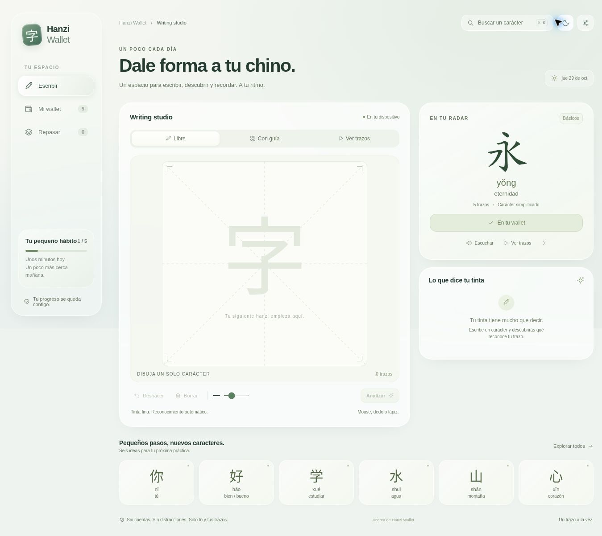

# Hanzi Wallet

A quiet space for Chinese handwriting. Write a character, compare your strokes, save what you want to learn, and come back for a short review.



Hanzi Wallet turns the original Hanzi Studio prototype into a typed, offline-capable web application. Its Liquid Glass–inspired interface uses translucent surfaces, a floating mobile tab bar, subtle jade colours, and accessible alternatives for reduced motion and transparency.

## Run locally

Requires Node.js **22.12 or newer**.

```bash
npm ci
npm run dev
```

Open the URL printed by Vite. Everything needed for recognition is bundled; you do not need API keys, a backend, a CDN, or a training step.

```bash
npm test             # model parity, vocabulary coverage, stroke evaluation, persistence and review scheduling
npm run typecheck    # strict TypeScript, including unchecked index access
npm run build        # production bundle and versioned offline service worker
npm run preview      # inspect the production build
```

## What you can do

- Write with a mouse, finger, or pen. Ink defaults to **2.6 CSS pixels**, uses coalesced pointer events, quadratic smoothing, a high-DPI canvas, and preserves drawings on resize.
- Recognize **151 distinct simplified Chinese characters**, with five ranked hypotheses. Select a candidate to inspect its shape, stroke order, and direction.
- Practise against a stroke guide, watch a stroke animation, undo a stroke, and adjust ink width.
- Confirm up to five handwriting examples per character. These local examples supplement geometric recognition and travel with JSON backups.
- Save a personal collection, search by hanzi, pinyin with or without tone marks, meaning, or category.
- Review due cards with a finite session. Answers are revealed before grading; forgetting schedules another review in ten minutes. Successful reviews use increasing intervals.
- Use light, dark, or system appearance; reduce transparency; follow a small daily writing goal.
- Export and import progress. Existing `hanzi-studio-v2` browser data is migrated where the origin is the same. Across origins/devices, use a JSON export.
- Install as a PWA and return offline **after the initial production load and offline cache installation finish**.

The first visit starts with eight saved characters and zero invented learning progress. Consolidation requires a review interval of at least seven days. The daily goal counts distinct characters that pass guided writing that day.

## Recognition: what changed

The original file trained a 20-class CNN in the browser on a small set of device-rendered font images. The replacement is ready at startup:

1. A pretrained MLP with **three hidden layers (192 → 96 → 64)** reads a normalized 24 × 24 ink representation, stroke-count features, direction histogram, and aspect ratio.
2. A geometric shortlist broadens the neural hypotheses before sequence alignment and dynamic time warping compare stroke trajectories.
3. Confirmed personal examples supplement the geometric comparison. All inference runs in a Web Worker.
4. Assessment separately checks shape, order, direction, missing strokes, and extra strokes. Recognition never treats the selected practice target as the answer.

**This is a bounded learning assistant, not a general Chinese handwriting recognizer.** The bundled model is trained on augmented canonical stroke data, not on a human handwriting corpus. Synthetic validation metrics are in [`public/model/metrics.json`](public/model/metrics.json); they do not establish accuracy on real users. Similarity scores and softmax outputs are uncalibrated. Ambiguous or out-of-vocabulary drawings can still resemble supported characters. Users should compare the candidates.

See [the model card](docs/MODEL_CARD.md), [architecture](docs/ARCHITECTURE.md), and [verification record](docs/VERIFICATION.md).

## Reproduce training

The checked-in model is usable without Python. To retrain it:

```bash
python3 -m venv .venv
source .venv/bin/activate
pip install -r scripts/requirements.txt
node scripts/prepare_data.mjs
OPENBLAS_NUM_THREADS=2 OMP_NUM_THREADS=2 npm run train
npm test
npm run build
```

The script regenerates the model, an independent synthetic augmentation benchmark, and Python/JavaScript numerical parity fixtures. Fixed seeds make the procedure repeatable; exact floating-point results can differ across library and BLAS versions. `.venv` is excluded from Git.

## Deploy

The output is the static `dist/` directory. Relative asset URLs support deployment at a subpath, including GitHub Pages. The repository includes a GitHub Pages workflow. In the repository's **Settings → Pages**, choose **GitHub Actions** as the build source and run the Pages workflow if it is not already configured. No secrets are needed.

`/.openai/hosting.json` is an optional deployment identity for the companion Sites preview; it is not needed for GitHub Pages. Do not copy another project's Site identity when forking.

## Privacy and limits

- Ink, personal examples, collection, and history stay in this browser's storage. There is no analytics SDK or remote inference API.
- Normal page and asset requests still reach whichever host serves the application. Optional speech uses the browser's installed Mandarin voice; voice availability depends on the device and browser.
- Local storage is not an account or cross-device sync. Private browsing, storage eviction, and device loss can erase it. Export a copy when you need to keep progress.
- If the neural model cannot load, geometric recognition remains available. Initial data loading and Web Worker failures are reported in the interface.
- The code has no production npm dependencies. Training and development dependencies are separate from the shipped application.

## Data and licences

Application code: [MIT](LICENSE). Stroke outlines and medians: [Hanzi Writer Data](https://github.com/chanind/hanzi-writer-data), derived from [Make Me a Hanzi](https://github.com/skishore/makemeahanzi) and Arphic fonts, under the included [Arphic Public License](public/data/ARPHICPL.txt). Data are repackaged and coordinates transformed; original outlines are preserved. See [NOTICE](NOTICE) for the derivative model's distribution terms and attribution.

This is an independent web application. Apple does not sponsor or endorse it.
