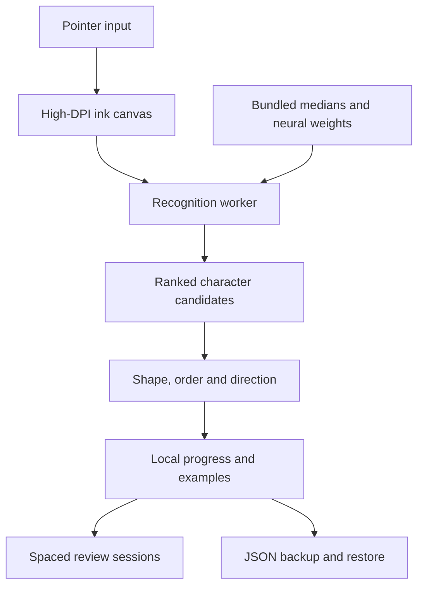

# Architecture

Hanzi Wallet is a static Vite application with strict TypeScript and no production npm dependencies. It does not require a backend.

## Modules

| Module                      | Responsibility                                                                                                                   |
| --------------------------- | -------------------------------------------------------------------------------------------------------------------------------- |
| `src/ink.ts`                | Pointer capture, coalesced events, pressure, smoothing, resize-safe normalized points, undo and cancel behaviour.                |
| `src/core/geometry.ts`      | Normalization, feature extraction, arc-length resampling, shortlisting, DTW, sequence alignment, and separate stroke assessment. |
| `src/core/neural.ts`        | Inference from the exported dense weights; stable softmax and shape checks.                                                      |
| `src/core/recognition.ts`   | Independent character retrieval, candidate blending, rejection, and local prototype comparisons.                                 |
| `src/recognition.worker.ts` | Worker protocol and isolated inference; request IDs discard stale results.                                                       |
| `src/core/storage.ts`       | Import validation, bounded history and prototypes, legacy migration, persistence errors, and review scheduling.                  |
| `src/main.ts`               | Accessible views, progress, dialogs, practice state, collection, reviews, backups, speech and PWA registration.                  |
| `scripts/train_model.py`    | Reproducible synthetic training, evaluation, weights and parity fixtures.                                                        |
| `scripts/build_offline.mjs` | A content-versioned same-origin cache manifest for the exact production build.                                                   |

## Interaction and state

The canvas keeps normalized points as its source of truth. Changing its physical size redraws points instead of erasing the drawing. Only the primary active pointer contributes ink; a cancelled pointer removes its unfinished stroke. Input captures coalesced points and draws through animation frames using quadratic curves. Pressure affects line width for pens.

Recognition waits 700 ms after the last completed stroke or runs on explicit analysis. Every new pointer action invalidates earlier worker results. Selecting a practice target does not change recognition probabilities. Confirmed prototypes are separate from the neural model.

Wallet progress is versioned at `hanzi-wallet-v3`. Imports allow only known characters, finite bounded scheduling values, valid normalized points, limited examples, and bounded history. Text is escaped before dynamic HTML rendering. The application migrates the original `hanzi-studio-v2` key when it can access that same browser origin.

Reviews use a finite queue. Rating is disabled until the card is revealed. An incorrect answer is due in ten minutes and does not cycle immediately back into the current session. The schedule grows from one to three days, then according to a bounded ease value. Consolidation starts at a seven-day interval.

## Offline and deployment

`dist/` contains every required vocabulary, outline, median, model and code asset. The generated service worker precaches these together; the interface reports offline readiness only after the production worker becomes active. Updates install in the background and activate on a later visit instead of reloading an active drawing session.

URLs are relative so a GitHub Pages repository subpath works. The Pages workflow builds the exact tested source. The optional `.openai/hosting.json` is specific to the companion Site and is not an application dependency.

## Trade-offs

- A small MLP is easier to ship and inspect than a large handwriting model, but synthetic data limit its generalization. Geometry adds stroke information and personalization at a higher compute cost.
- Candidate shortlisting keeps DTW responsive. A candidate omitted by all shortlisting paths cannot be recovered by reranking; future human benchmarks should measure shortlist recall.
- A static architecture avoids backend setup and ink transmission. It also means progress requires manual backups across devices and can be lost with browser storage.
- Web speech depends on installed voices. Missing Mandarin voices produce an explicit message; no undocumented remote speech service is added.
- A CSS Liquid Glass interpretation preserves web portability. It does not reproduce Apple's native compositor or imply an iOS-native application.
