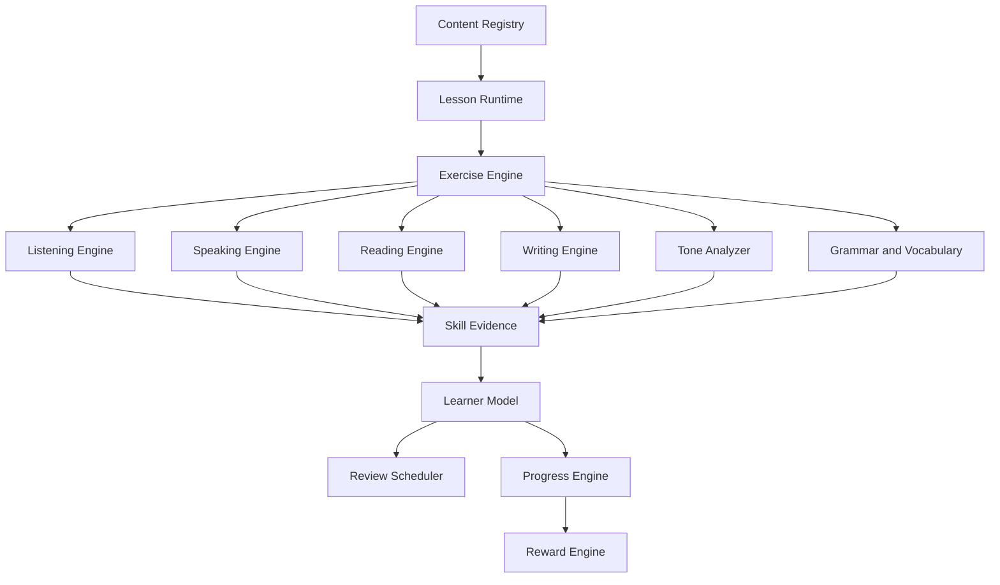

<!-- Fuente: investigación del usuario. Copia de referencia sin el apéndice de configuración local. -->

# Hanzi Wallet

## Investigación pedagógica, científica y técnica para convertir la aplicación en una plataforma integral de aprendizaje del mandarín

**Versión del documento:** 1.0\
**Fecha de corte de la investigación:** 14 de noviembre de 2026\
**Proyecto:**
[deepdevjose/hanzi-wallet](https://github.com/deepdevjose/hanzi-wallet)\
**Idioma:** español\
**Estado:** investigación y propuesta; no constituye una especificación
de implementación aprobada ni afirma que las funcionalidades propuestas
ya estén desarrolladas.

---

## Resumen ejecutivo

Hanzi Wallet debe evolucionar de una herramienta centrada en reconocer y
escribir caracteres chinos a una plataforma integral para adquirir
mandarín. El objetivo no es sustituir el estudio de hanzi, sino
conectarlo con el vocabulario, la gramática, la pronunciación, la
comprensión auditiva, la lectura y la producción oral.

La recomendación central es organizar el aprendizaje alrededor de
**objetivos comunicativos y situaciones reales** ---presentarse, pedir
comida, preguntar direcciones, conversar en la universidad--- y utilizar
los caracteres, las palabras, las estructuras y los ejercicios como
recursos para alcanzar esos objetivos.

HSK debe funcionar como marco de referencia, diagnóstico y preparación
de exámenes; no debe ser la única secuencia pedagógica. La plataforma
debe permitir que una persona principiante aprenda los fundamentos del
sistema de escritura y la fonología, mientras que una persona con
experiencia pueda demostrar lo que ya sabe y avanzar hacia contenidos
más complejos sin repetir innecesariamente los fundamentos.

La evidencia consultada respalda varias decisiones de diseño:

1.  La práctica espaciada y la recuperación activa mejoran la retención
    de segundas lenguas.
2.  La lectura extensiva con textos graduados puede beneficiar no solo
    la comprensión lectora, sino también vocabulario, fluidez,
    motivación y otras competencias.
3.  La instrucción de tonos debe combinar percepción, explicación
    fonética, producción y retroalimentación visual; escuchar y hablar
    deben medirse por separado.
4.  La escritura de caracteres está relacionada con el procesamiento de
    la lectura, pero la práctica debe ser significativa y no limitarse a
    copiar repetidamente.
5.  Los componentes semánticos y fonéticos pueden ayudar a interpretar
    caracteres y palabras nuevas, siempre que se expliquen sus límites.
6.  La interacción y la retroalimentación correctiva son herramientas
    relevantes para desarrollar la capacidad de producir lenguaje.
7.  La gamificación puede ayudar a la motivación, pero sus efectos sobre
    la competencia percibida y el aprendizaje no son automáticos.
8.  La interfaz debe reducir la carga cognitiva innecesaria, sincronizar
    texto y audio, segmentar las actividades y ofrecer retroalimentación
    comprensible.

La estrategia técnica recomendada es conservar la base TypeScript, PWA y
offline-first del proyecto y añadir un **Learning Engine** basado en
contenido declarativo, actividades reutilizables, evidencias separadas
por habilidad y un planificador de repasos. No se recomienda reescribir
la aplicación.

---

# 1. Alcance y criterio de evidencia

Este documento combina cuatro tipos de información. Es importante no
confundirlos:

- **Estándares oficiales:** describen marcos de competencia, listas de
  caracteres o normas de escritura publicadas por instituciones
  chinas.
- **Investigación académica:** resultados de experimentos, estudios
  observacionales y metaanálisis publicados en revistas académicas o
  repositorios científicos.
- **Documentación técnica:** especificaciones de APIs, datasets,
  licencias y herramientas.
- **Recomendaciones de producto:** decisiones propuestas para Hanzi
  Wallet a partir de la evidencia, de las limitaciones del repositorio
  y de los objetivos del proyecto.

No todas las fuentes tienen el mismo poder explicativo. Un metaanálisis
puede sintetizar muchos estudios, pero no necesariamente se refiere al
aprendizaje del mandarín. Un experimento sobre tonos puede ser
directamente pertinente, aunque tenga una muestra pequeña. Un estudio
observacional con muchos estudiantes puede detectar asociaciones, pero
no demostrar causalidad.

Por ello, cada conclusión debe interpretarse en su contexto. Las
recomendaciones de producto son hipótesis que deberán validarse con
usuarios y pruebas de aprendizaje.

**Alcance de neurociencia:** la investigación aquí reunida utiliza
principalmente adquisición de segundas lenguas, psicología cognitiva,
memoria, fonética, alfabetización china y aprendizaje multimedia. No se
afirma que una técnica funcione porque "active una zona del cerebro" ni
se utilizan explicaciones simplistas sobre dopamina. La evidencia sobre
memoria y aprendizaje se traduce a decisiones pedagógicas observables;
no se inventan mecanismos neuronales que los estudios citados no hayan
medido.

---

# 2. Dirección del producto

## 2.1. De un entrenador de caracteres a una plataforma de adquisición del idioma

La unidad principal del producto no debería ser el carácter aislado.
Debería ser el **objetivo comunicativo**.

Ejemplos:

- Comprender un saludo.
- Presentarse y preguntar el nombre de otra persona.
- Pedir una bebida.
- Entender una indicación en una estación.
- Hablar de los estudios y horarios.
- Mantener una conversación informal.

Cada misión incorpora las habilidades necesarias:

- Listening: comprender el mensaje recibido.
- Speaking: producir una respuesta.
- Reading: interpretar caracteres, palabras y oraciones.
- Writing: reconocer y producir caracteres o frases cuando sea
  pertinente.
- Pronunciation: articular sonidos, tonos, ritmo y entonación.

El aprendizaje de caracteres continúa siendo esencial, pero se conecta
con palabras, expresiones y textos. Las flashcards y el reconocimiento
de escritura pasan a ser herramientas dentro de un recorrido más amplio.

## 2.2. Tres sistemas que deben coexistir

---

Sistema Función

---

HSK y estándares oficiales Referencia de competencia,
cobertura, diagnóstico y
preparación de exámenes.

Hanzi Wallet Learning Path Secuencia pedagógica propia,
organizada por objetivos,
habilidades y situaciones reales.

Biblioteca de caracteres Referencia para consultar,
reconocer, escribir y estudiar
caracteres.

---

No deben compartir obligatoriamente los mismos niveles ni el mismo
orden. HSK describe niveles de competencia y contenidos; el Learning
Path organiza experiencias de aprendizaje; la biblioteca permite
explorar el sistema de escritura.

## 2.3. Principios de producto

1.  El usuario debe saber qué está aprendiendo y para qué sirve.
2.  Cada lección debe incluir una actividad de recuperación, no solo
    exposición.
3.  La evidencia de una habilidad no debe utilizarse para declarar
    dominadas otras habilidades.
4.  El usuario avanzado debe poder demostrar conocimientos y saltarse
    contenidos dominados.
5.  El pinyin y la traducción deben ser ayudas configurables, no
    dependencias permanentes.
6.  La gamificación debe recompensar progreso acreditado y no repetición
    artificial.
7.  La aplicación debe seguir funcionando sin conexión para las
    funciones que no requieran servicios remotos.
8.  Las explicaciones históricas y lingüísticas deben distinguir datos
    documentados de recursos mnemotécnicos inventados.

---

# 3. Estándares chinos y HSK

## 3.1. Estándar internacional de competencia en chino GF0025-2021

El Ministerio de Educación de China publicó el estándar _Chinese
Proficiency Grading Standards for International Chinese Language
Education_, identificado como GF0025-2021.

El marco organiza la competencia en tres etapas y nueve niveles. Su
referencia cuantitativa incluye:

Dimensión Cantidad

---

Sílabas 1,110
Caracteres 3,000
Vocabulario 11,092 palabras
Gramática 572 elementos
Habilidades Escuchar, hablar, leer, escribir y traducir

El estándar también incorpora descripciones de niveles, temas, tareas y
ámbitos de comunicación.

**Implicación:** una plataforma de aprendizaje de chino no puede tratar
los caracteres como sustituto del vocabulario, la gramática o la
competencia comunicativa. El estándar ofrece una matriz de cobertura
mucho más amplia que una lista de hanzi.

Fuente oficial: - [Ministerio de Educación de China: explicación del
estándar
GF0025-2021](https://www.moe.gov.cn/jyb_xwfb/s271/202104/t20210402_524194.html) -
[Portal del Ministerio de Educación: estándar de educación internacional
de
chino](https://hudong.moe.gov.cn/jyb_xwfb/moe_2082/siju/yywzxxgls/ztzl_yywzgfbz/202111/t20211118_580755.html)

## 3.2. HSK 3.0

A la fecha de corte de este documento, el lanzamiento mundial de HSK 3.0
está anunciado para el **13 de diciembre de 2026**. Por tanto, el 14 de
noviembre de 2026 todavía es una fecha futura respecto al corte de esta
investigación.

El sitio oficial de Chinese Test Service describe cinco componentes del
nuevo programa:

- Tareas.
- Temas.
- Vocabulario.
- Gramática.
- Caracteres chinos.

Esto refuerza la decisión de no reducir el currículo a listas de
caracteres.

Fuentes: - [Chinese Test Service: HSK](https://www.chinesetest.cn/HSK) -
[Anuncio de lanzamiento de HSK 3.0, 13 de diciembre de
2026](https://old.chinesetest.cn/gonewcontent.do?flag=kdnew&id=51336883) -
[Anuncio institucional de Shanghai, 15 de septiembre de
2026](https://edu.sh.gov.cn/study_en_news/20260915/f7034aa15cad4a92a6183abeea104895.html)

**Recomendación:** HSK debe ser una capa de alineación curricular. Cada
palabra, carácter, estructura, tema, tarea y actividad puede
relacionarse con uno o varios niveles. El orden de enseñanza de Hanzi
Wallet debe seguir las necesidades comunicativas y los prerrequisitos
reales.

## 3.3. La lista de 3,500 caracteres

La lista oficial de caracteres comunes de primer nivel publicada en 2013
es una referencia útil para ampliar la biblioteca de caracteres.

Fuente: - [Consejo de Estado de China: lista de caracteres comunes,
2013](https://www.gov.cn/zwgk/2013-08/19/content_2469793.htm)

No debe confundirse con la lista de 3,000 caracteres del estándar
GF0025-2021. Son referencias distintas, con objetivos y criterios
diferentes. Tampoco debe asumirse que dominar 3,500 caracteres equivale
a dominar el idioma.

## 3.4. Norma de orden de trazos

La norma GF0023-2020, _Stroke Orders of the Commonly Used Standard
Chinese Characters_, fue publicada por el Ministerio de Educación y la
Comisión Estatal de Lengua y Escritura de China.

Fuente: - [PDF oficial GF0023-2020, Ministerio de
Educación](https://www.moe.gov.cn/jyb_sjzl/ziliao/A19/202103/W020210318300204215237.pdf)

**Recomendación:** utilizar la norma como referencia para el orden de
escritura de los caracteres cubiertos. No enseñar las reglas generales
como si fueran leyes sin excepciones: deben acompañarse de ejemplos y de
la secuencia validada de cada carácter.

---

# 4. Qué dice la investigación sobre cómo se aprende un idioma

## 4.1. Recuperación activa y práctica espaciada

### Metaanálisis de práctica espaciada en segundas lenguas

Kim y Webb (2022), en _Language Learning_, sintetizaron 48 experimentos
con 3,411 participantes y 98 tamaños de efecto.

Resultados principales:

- La práctica espaciada tuvo un efecto entre moderado y grande frente
  a la práctica masiva.
- Los intervalos más largos fueron más beneficiosos para pruebas
  diferidas que para pruebas inmediatas.
- La evidencia no mostró una diferencia general estadísticamente
  significativa entre intervalos uniformes y expansivos.

Fuente: - [Kim & Webb (2022), The Effects of Spaced Practice on Second
Language Learning: A Meta-Analysis](https://doi.org/10.1111/lang.12479)

### Recuperación activa

Karpicke y Roediger (2008), en _Science_, estudiaron la importancia de
recuperar información de la memoria. En su experimento de vocabulario
extranjero, volver a probar la recuperación después de aprender produjo
una ventaja de retención diferida frente a limitarse a volver a estudiar
el material.

Fuente: - [Karpicke & Roediger (2008), The Critical Importance of
Retrieval for Learning](https://doi.org/10.1126/science.1152408) -
[Registro PubMed](https://pubmed.ncbi.nlm.nih.gov/18276894/)

### Aplicación a Hanzi Wallet

No basta con mostrar una palabra o un carácter y marcarlo como
aprendido. El sistema debe pedir al usuario que lo recupere sin ayuda y
volver a evaluarlo después de un intervalo.

El planificador debe operar sobre diferentes tipos de contenido:

- Caracteres.
- Palabras.
- Expresiones.
- Estructuras gramaticales.
- Contrastes fonéticos.
- Comprensión de audio.
- Comprensión de lectura.

Los intervalos concretos no deben presentarse como una receta universal.
Se deben ajustar con evidencia de retención, errores y dificultad.

Ejemplo inicial de secuencia de producto, no prescripción científica:

Momento Actividad

---

Primera sesión Aprender y recuperar inmediatamente.
Día siguiente Recuperar sin consultar la explicación.
Día 3 Reconocer la palabra en audio.
Día 7 Utilizarla en una frase nueva.
Día 14 Recuperarla dentro de un texto o diálogo.

## 4.2. Lectura extensiva y textos graduados

Sangers y colaboradores (2025), en _Educational Psychology Review_,
publicaron una metaanálisis sobre lectura extensiva en segundas lenguas.

La investigación encontró efectos positivos en:

- Comprensión lectora.
- Vocabulario.
- Decodificación y fluidez.
- Motivación.
- Escritura.
- Competencia oral.
- Competencia lingüística general.

Los efectos variaron entre pequeños y medianos. Los programas que
limitaban la selección de textos a materiales apropiados para el nivel y
que incluían algún mecanismo de seguimiento tendían a obtener resultados
mayores.

Fuente: - [Sangers et al. (2025), Learning a Language Through Reading: A
Meta-analysis](https://doi.org/10.1007/s10648-025-10068-6)

### Aplicación: Chinese World

Crear una biblioteca de lectura graduada con:

- Conversaciones cotidianas.
- Historias cortas.
- Mensajes y anuncios.
- Situaciones de universidad, transporte, compras y restaurantes.
- Noticias adaptadas.
- Textos culturales.

Cada texto debe tener:

- Nivel de dificultad estimado.
- Vocabulario conocido y nuevo.
- Estructuras gramaticales utilizadas.
- Pinyin opcional.
- Audio natural.
- Glosario contextual.
- Preguntas de comprensión.
- Procedencia y derechos de uso del texto y del audio.

El pinyin debe poder ocultarse. La traducción no debe aparecer
automáticamente si el objetivo es evaluar comprensión.

## 4.3. Comprensión auditiva

Chang (2024), en _International Journal of Listening_, sintetizó 32
estudios primarios con 2,797 participantes.

La metaanálisis encontró un efecto pequeño de la instrucción de
comprensión auditiva (Cohen's d = 0.25). La metarregresión indicó que
los periodos de intervención más largos se asociaban con mejores
resultados.

Fuente: - [Chang (2024), The Effect of Listening Instruction on the
Development of L2 Learners' Listening
Competence](https://doi.org/10.1080/10904018.2022.2074851) - [ERIC:
registro del artículo](https://eric.ed.gov/?id=EJ1423906)

### Aplicación: Listening Gym

El módulo debe enseñar a escuchar con objetivos concretos, no limitarse
a reproducir audio.

Progresión propuesta:

1.  Sound recognition: reconocer sílabas, iniciales, finales y tonos.
2.  Word recognition: identificar palabras dentro de una grabación.
3.  Sentence comprehension: comprender oraciones.
4.  Natural listening: comprender conversaciones con velocidad y
    entonación naturales.

Secuencia recomendada para un ejercicio:

- Primera escucha sin texto: captar la idea general.
- Segunda escucha: identificar información específica.
- Tercera escucha: consultar la transcripción, el vocabulario y la
  pronunciación.

La actividad debe evaluar comprensión. Reproducir varias veces un audio
no demuestra por sí solo que el estudiante lo haya entendido.

## 4.4. Pronunciación y tonos del mandarín

### Retroalimentación visual con Praat

Mengtian Chen publicó un estudio sobre retroalimentación digital para la
pronunciación de tonos del mandarín en _Computer Assisted Language
Learning_ (publicación en volumen de 2024; disponible online desde
2022).

Participaron 44 principiantes durante cuatro semanas. Un grupo recibió
retroalimentación digital con Praat para visualizar contornos tonales y
escuchar versiones corregidas de sus propias voces. El grupo de
comparación recibió retroalimentación visual y auditiva del
investigador.

Ambos grupos mejoraron, pero el grupo asistido por Praat mostró avances
significativamente mayores. Los participantes valoraron la comparación
visual directa de sus contornos tonales.

Fuente: - [Chen, Computer-aided feedback on the pronunciation of
Mandarin Chinese tones](https://doi.org/10.1080/09588221.2022.2037652) -
[Duke Scholars: ficha de la
publicación](https://scholars.duke.edu/publication/1510695) - [ERIC:
resumen del estudio](https://eric.ed.gov/?id=EJ1422940)

**Interpretación:** existe evidencia experimental directamente
relacionada con la idea de mostrar al estudiante una representación de
su propia producción tonal. No demuestra que cualquier gráfico o
algoritmo automático vaya a funcionar igual: la implementación debe
validarse.

### Instrucción explícita y variabilidad de hablantes

Wiener, Chan e Ito (2020) estudiaron la instrucción explícita de
contornos tonales y la variabilidad de hablantes. El experimento utilizó
una tarea de aprendizaje de una lengua artificial similar al mandarín,
con participantes angloparlantes, estudiantes intermedios y hablantes
nativos como parte del diseño.

La instrucción explícita facilitó la producción de contornos ascendentes
y descendentes. La variabilidad de hablantes por sí sola no produjo un
efecto principal general, aunque interactuó con la instrucción explícita
para algunos resultados.

Fuente: - [Wiener, Chan & Ito (2020), Do Explicit Instruction and High
Variability Phonetic Training Improve Nonnative Speakers' Mandarin Tone
Productions?](https://doi.org/10.1111/modl.12619)

**Límite:** no debe interpretarse como una demostración directa de que
una secuencia concreta de entrenamiento garantiza fluidez en
conversaciones naturales. Es evidencia a favor de combinar explicación
explícita con exposición variable, no de sustituir la comunicación real.

### Percepción y producción son habilidades relacionadas, pero no intercambiables

Li y DeKeyser (2017) estudiaron práctica de percepción y producción en
el aprendizaje de palabras tonales del mandarín con 38 adultos
angloparlantes. El rendimiento fue peor cuando se evaluó la habilidad
inversa a la practicada, lo que respalda la especificidad de la
práctica.

Fuente: - [Li & DeKeyser (2017), Perception Practice, Production
Practice, and Musical Ability in L2 Mandarin Tone-Word
Learning](https://doi.org/10.1017/S0272263116000358) - [ERIC: registro
del artículo](https://eric.ed.gov/?id=EJ1164195)

### Aplicación: Tone Lab

El módulo debe separar cinco etapas:

1.  Observe: escuchar y visualizar el contorno de referencia.
2.  Discriminate: distinguir dos sonidos iguales o diferentes.
3.  Identify: reconocer el tono sin ver el pinyin.
4.  Produce: grabar la propia voz.
5.  Compare: comparar la curva producida con una referencia y recibir
    orientación.

Contenido progresivo:

- Cuatro tonos léxicos y tono neutro.
- Iniciales y finales del pinyin.
- Pares de tonos.
- Secuencias de varias sílabas.
- Cambios tonales (_tone sandhi_).
- Ritmo y entonación de frases.
- Pronunciación en conversaciones.

La enseñanza de cambios tonales debe distinguir el tono léxico
representado en pinyin de su realización fonética en contexto. Por
ejemplo, en 你好, la realización de 你 cambia ante 好, aunque el pinyin
convencional conserve los tonos léxicos.

### Arquitectura técnica del análisis tonal

El análisis tonal puede utilizar:

- `getUserMedia()` para solicitar acceso explícito al micrófono.
- `MediaRecorder` para grabar cuando se necesite conservar una
  muestra.
- `AudioWorklet` para procesamiento de audio en tiempo real.
- Un estimador de frecuencia fundamental (F0) y un detector de voz.
- Normalización relativa al rango tonal del hablante.
- Una visualización de confianza y calidad de señal.

No debe compararse únicamente una frecuencia absoluta entre personas. El
rango tonal varía entre hablantes. También se deben detectar silencio,
ruido, señal insuficiente y errores de seguimiento de F0.

La salida inicial debe ser una ayuda pedagógica ---por ejemplo, "tu voz
asciende al final"---, no una nota automática de pronunciación con
apariencia de precisión científica.

## 4.5. Escritura de caracteres y lectura

### Evidencia experimental de neuroimagen

Un estudio de aprendizaje de caracteres chinos comparó una condición de
escritura de caracteres con otra de escritura de pinyin. Después del
aprendizaje, el grupo de escritura de caracteres mostró diferencias en
la activación de redes relacionadas con el procesamiento visual-espacial
y ortográfico durante tareas de lectura.

Fuente: - [Writing affects the brain network of reading in Chinese: A
functional magnetic resonance imaging
study](https://pmc.ncbi.nlm.nih.gov/articles/PMC6870511/)

La investigación respalda la relación entre la práctica de escritura y
la representación ortográfica del carácter. No demuestra que copiar
muchas veces sea el mejor método para todos los caracteres o
estudiantes.

### Evidencia observacional a gran escala

Un estudio con datos de 74,362 estudiantes de chino como segunda lengua
y 67 lenguas maternas encontró una asociación significativa entre
competencia de escritura de caracteres y rendimiento lector.

Fuente: - [Exploring Relationships Between L2 Chinese Character Writing
and Reading Acquisition From Embodied Cognitive
Perspectives](https://pmc.ncbi.nlm.nih.gov/articles/PMC8900728/)

**Límite:** es evidencia observacional; no debe afirmarse que la
asociación prueba causalidad por sí sola.

### Aplicación

La escritura debe combinar:

1.  Observación de la forma.
2.  Comprensión de la estructura.
3.  Práctica guiada.
4.  Escritura de memoria.
5.  Uso del carácter en una palabra.
6.  Lectura de esa palabra dentro de una oración.

La práctica de escritura no debe convertirse en copiar repetidamente sin
recuperar el carácter de memoria.

## 4.6. Componentes, radicales y estructura de los caracteres

Es necesario distinguir:

- **Stroke:** unidad gráfica de un carácter.
- **Component:** parte estructural que forma un carácter.
- **Radical:** componente utilizado como referencia clasificatoria en
  diccionarios y sistemas de indexación.
- **Semantic component:** componente que puede aportar una pista
  semántica.
- **Phonetic component:** componente que puede aportar una pista
  fonética.

Un trazo no tiene necesariamente un significado léxico propio. Su
función es gráfica. El significado se aprende mediante caracteres,
palabras y contexto.

### Estudio sobre radicales semánticos

Nguyen y colaboradores (2017) estudiaron a 54 estudiantes universitarios
vietnamitas que llevaban aproximadamente un año aprendiendo chino. La
intervención enseñó radicales semánticos y evaluó si podían inferir
caracteres desconocidos dentro de oraciones.

Los grupos experimentales mejoraron y transfirieron la estrategia a
materiales con radicales semánticos no enseñados directamente.

Fuente: - [Nguyen et al. (2017), Teaching Semantic Radicals Facilitates
Inferring New Character Meaning in Sentence Reading for Nonnative
Chinese Speakers](https://doi.org/10.3389/fpsyg.2017.01846)

**Límite:** la muestra fue específica y los participantes ya tenían
experiencia previa. No justifica enseñar todos los radicales de forma
aislada a un principiante absoluto.

### Aplicación: Radical & Component Academy

Comenzar con componentes frecuentes dentro de palabras ya conocidas:

- 口
- 人 / 亻
- 木
- 水 / 氵
- 手 / 扌
- 日

Enseñar que algunos componentes aportan pistas semánticas y otros
fonéticas. Las pistas tienen excepciones y no deben convertirse en
reglas absolutas.

Ejemplo:

- 妈 = 女 + 马.
- 女 aporta una pista semántica.
- 马 aporta una pista fonética aproximada.
- La relación no garantiza que todos los caracteres con 马 tengan la
  misma pronunciación o tono.

## 4.7. Etimología e historia de los hanzi

La plataforma debería incorporar una sección de historia de caracteres,
pero debe separar:

- Historia documentada.
- Evolución gráfica.
- Análisis filológico.
- Componentes actuales.
- Recursos mnemotécnicos inventados para recordar.

Cuando exista evidencia, puede mostrarse la evolución desde formas
antiguas ---por ejemplo, huesos oraculares, escritura de bronce, sello,
escritura clerical y escritura regular---. No todos los caracteres
tienen una secuencia histórica completa o igualmente documentada.

Una historia mnemotécnica puede ser útil, pero nunca debe presentarse
como origen histórico si no existe evidencia filológica.

## 4.8. Palabras compuestas y significado contextual

Hao, Wu y Duan (2024) estudiaron cómo hablantes nativos y estudiantes de
chino como segunda lengua procesan palabras compuestas. Encontraron que
intervienen tanto representaciones de la palabra completa como de sus
morfemas, con influencia de frecuencia, transparencia semántica y
estructura de la palabra.

Fuente: - [Hao, Wu & Duan (2024), Processing Mandarin Chinese Compound
Words by Native Speakers and Second Language
Learners](https://doi.org/10.1177/21582440241256249)

### Aplicación

El catálogo debe conectar:

- Caracteres.
- Palabras.
- Significados contextuales.
- Pronunciaciones.
- Estructuras gramaticales.
- Ejemplos.
- Oraciones.
- Lecturas y diálogos.

Ejemplos:

Caracteres Pinyin Significado contextual

---

小心 xiǎoxīn Tener cuidado
东西 dōngxi Cosa / objeto
学生 xuésheng Estudiante
朋友 péngyou Amigo
手机 shǒujī Teléfono móvil
火车 huǒchē Tren

No se debe traducir mecánicamente cada carácter y asumir que la suma
explica siempre la palabra.

## 4.9. Interacción, producción y retroalimentación correctiva

La interacción permite combinar:

- Input: recibir lenguaje.
- Negotiation of meaning: aclarar lo que no se entiende.
- Output: producir lenguaje propio.

Una revisión académica sobre interacción en adquisición de segundas
lenguas describe la negociación del significado y la producción como
procesos relevantes.

Fuente: - [Cambridge University Press: Interaction and instructed second
language
acquisition](https://www.cambridge.org/core/journals/language-teaching)

Li (2010) publicó una metaanálisis de retroalimentación correctiva en
adquisición de segundas lenguas que reunió 33 estudios primarios.
Encontró un efecto general medio y evidencia de mantenimiento del efecto
a lo largo del tiempo.

Fuente: - [Li (2010), The Effectiveness of Corrective Feedback in SLA: A
Meta-Analysis](https://doi.org/10.1111/j.1467-9922.2010.00561.x)

### Aplicación: Conversation Studio

Escenarios recomendados:

Escenario Objetivo

---

Meet someone Presentarse y preguntar nombres
At a restaurant Pedir comida y bebidas
At university Preguntar por clases y horarios
Shopping Preguntar precios y cantidades
With friends Mantener una conversación informal
At the train station Pedir información e indicaciones

Dos modos:

- **Immersion Mode:** la conversación fluye sin interrupciones; al
  terminar se recibe un resumen de errores y oportunidades de mejora.
- **Coach Mode:** el sistema ofrece ayuda y correcciones durante la
  conversación.

La IA debe adaptar el nivel y utilizar vocabulario y estructuras que el
usuario pueda comprender. No debe reemplazar la práctica humana ni ser
presentada como un evaluador infalible.

---

# 5. HCI y aprendizaje multimedia

## 5.1. Teoría cognitiva del aprendizaje multimedia

Richard E. Mayer describe una teoría basada en tres supuestos:

1.  Existen canales de procesamiento visual/pictórico y auditivo/verbal.
2.  La capacidad de cada canal es limitada.
3.  El aprendizaje significativo requiere procesamiento activo y
    coordinado.

Fuente: - [Mayer, Cognitive Theory of Multimedia Learning, Cambridge
University
Press](https://www.cambridge.org/core/books/abs/cambridge-handbook-of-multimedia-learning/cognitive-theory-of-multimedia-learning/3A0E495CDB9D9D84665FAEFCBAB51D05)

Principios especialmente útiles para Hanzi Wallet:

---

Principio Aplicación

---

Coherence Eliminar elementos visuales
irrelevantes.

Signaling Destacar el carácter, sonido o
estructura importante.

Spatial contiguity Colocar pinyin junto al carácter
correspondiente.

Temporal contiguity Sincronizar audio y animación.

Segmenting Dividir la lección en pasos
manejables.

Pre-training Explicar conceptos fundamentales
antes de utilizarlos.

Personalization Utilizar explicaciones naturales y
comprensibles.

---

No se debe saturar una pantalla con explicaciones, animaciones,
vocabulario y controles al mismo tiempo. La información debe aparecer
cuando sea necesaria.

## 5.2. Dashboard recomendado

El inicio debe responder:

- ¿Qué debería aprender ahora?
- ¿Qué necesito repasar?
- ¿Cómo estoy progresando?

Jerarquía propuesta:

1.  Tu siguiente misión.
2.  Repasos recomendados.
3.  Estado de habilidades.
4.  Accesos de práctica libre.
5.  Progreso del personaje, monedas y armario.

El armario y las recompensas deben mantenerse, pero no competir
visualmente con la misión de aprendizaje.

## 5.3. Onboarding y personalización

El primer inicio puede ofrecer personalización opcional:

- Idioma de interfaz, detectado inicialmente desde el navegador.
- Nivel declarado.
- Diagnóstico breve por habilidad.
- Objetivo principal.
- Tiempo disponible o frecuencia deseada.
- Intereses y contextos preferidos.

El nivel declarado no debe ser suficiente para asignar un nivel real.
Debe combinarse con una evaluación de colocación por habilidades.

Un usuario puede tener lectura avanzada y pronunciación inicial. El
sistema debe poder representar esa diferencia.

## 5.4. Accesibilidad y control

- Pinyin y traducción configurables.
- Subtítulos opcionales.
- Controles de velocidad de audio.
- Actividades que funcionen con teclado.
- Compatibilidad con pantalla táctil.
- Micrófono opcional, nunca obligatorio para continuar.
- Alternativa de selección o escucha si se deniega el permiso.
- Preferencia de movimiento reducido.
- Contraste y tamaño de texto adecuados.
- Mensajes de error concretos y recuperables.

---

# 6. Gamificación y motivación

Una metaanálisis y revisión sistemática sobre gamificación educativa
analizó 35 intervenciones independientes con 2,500 participantes.

Encontró un efecto positivo, pero pequeño, sobre la motivación
intrínseca (Hedges' g = 0.257). También observó efectos positivos en
autonomía y relación social, mientras que el efecto sobre competencia
percibida fue limitado.

Fuente: - [Gamification enhances student intrinsic motivation,
perceptions of autonomy and relatedness, but minimal impact on
competency](https://doi.org/10.1007/s11423-023-10337-7)

**Interpretación:** las monedas, niveles y objetos pueden apoyar la
motivación, pero no garantizan aprendizaje ni competencia lingüística.

## 6.1. Economía vinculada a evidencias

Acción Recompensa propuesta

---

Completar una misión XP y monedas
Recuperar vocabulario después de un intervalo XP
Superar una actividad de comprensión XP
Mejorar una habilidad Recompensa de progreso
Completar un reto semanal Recompensa adicional
Repetir infinitamente el mismo ejercicio Sin recompensa repetida

Reglas:

- Recompensar una vez por objetivo o mejora acreditada.
- Evitar monedas ilimitadas por reproducir audio o repetir clics.
- Mantener una economía transparente.
- No penalizar al estudiante por equivocarse.
- Evitar rachas que generen presión contraproducente.
- No convertir el tiempo de pantalla en la métrica principal.

## 6.2. Progresión del avatar

Mantener:

- Personaje base.
- Personalización del nombre.
- Ropa y accesorios.
- Sombreros y calzado.
- Personajes desbloqueables.
- Objetos por niveles y logros.

El personaje debe representar la continuidad y el progreso del usuario,
no sustituir los objetivos lingüísticos.

## 6.3. Aprendizaje social futuro

Cuando exista backend:

- Amigos.
- Retos cooperativos.
- Torneos de reconocimiento de caracteres.
- Torneos de escritura.
- Comprensión de palabras y frases.
- Desafíos de lectura.
- Conversaciones entre estudiantes.

La clasificación debe considerar dificultad, nivel y habilidad. No se
debe comparar directamente a un principiante con un estudiante avanzado.

---

# 7. Currículo propuesto

## 7.1. Ruta para principiantes

La ruta debe enseñar fundamentos en contexto y con práctica inmediata.

### A. Primeros sonidos

- Iniciales y finales del pinyin.
- Cuatro tonos y tono neutro.
- Contrastes auditivos.
- Producción guiada.
- Escucha y comparación.
- Primeras palabras y expresiones.

### B. Primeros trazos

- Horizontal.
- Vertical.
- Punto.
- Descendentes.
- Ascendente.
- Gancho.
- Giro.

Enseñar nombre, dirección, terminación y proporción. Un trazo es una
unidad gráfica; no tiene necesariamente un significado léxico propio.

### C. Reglas de escritura

Enseñar reglas generales con ejemplos y excepciones:

- Izquierda a derecha.
- Arriba abajo.
- Horizontal antes que vertical cuando corresponde.
- Exterior antes que interior en estructuras pertinentes.
- Cerrar al final cuando la estructura lo exige.

La secuencia de cada carácter debe apoyarse en datos validados.

### D. Componentes y radicales

Introducir componentes frecuentes dentro de caracteres y palabras
conocidas. Diferenciar componentes semánticos, fonéticos y radicales
clasificatorios.

### E. Primeras palabras y frases

Enseñar palabras de uso real y expresiones completas, no caracteres
aislados sin contexto.

### F. Primeras misiones comunicativas

- Saludar.
- Presentarse.
- Preguntar nombres.
- Hablar de nacionalidad y estudios.
- Pedir una bebida.
- Preguntar precios.

## 7.2. Ruta para usuarios con experiencia

Un estudiante que declara HSK 2, 3, 4 o superior no debe verse obligado
a repetir los fundamentos.

Proceso:

1.  Diagnóstico de lectura.
2.  Diagnóstico de escucha.
3.  Diagnóstico de vocabulario y gramática.
4.  Diagnóstico de pronunciación.
5.  Diagnóstico de escritura si el usuario quiere desarrollarla.
6.  Recomendación de ruta por habilidad.

Los resultados deben distinguir:

- Conocido por colocación.
- Practicado.
- Recuperado correctamente.
- Consolidado mediante pruebas diferidas.

No se deben inventar intentos, repasos, rachas ni recompensas por una
colocación inicial.

## 7.3. Primera misión vertical completa: Introducing Yourself

**Objetivo:** presentarse, preguntar el nombre de otra persona y
comprender su respuesta.

Secuencia propuesta:

1.  Listening: escuchar un microdiálogo natural.
2.  Comprensión: identificar quién se presenta y cómo se llama.
3.  Vocabulario: aprender 你好, 我叫 y 你叫什么名字.
4.  Gramática: comprender la estructura interrogativa y la presentación
    personal.
5.  Reading: leer el diálogo con pinyin opcional.
6.  Writing: practicar caracteres relevantes, guiados y después de
    memoria.
7.  Speaking: grabar una presentación propia.
8.  Retrieval: responder sin ayudas y programar repasos.

La duración inicial de 6--10 minutos es una hipótesis de diseño que debe
validarse con usuarios; no es un intervalo científicamente prescrito.

La misión debe tener contenido, audio, ejercicios, guardado,
retroalimentación y repaso. Es preferible completar una unidad vertical
de calidad antes de crear muchas pantallas vacías.

## 7.4. Segunda misión: pedir una bebida

Objetivo: pedir una bebida, reconocer opciones y comprender una pregunta
sencilla.

Actividades:

- Escuchar una interacción en una cafetería.
- Reconocer nombres de bebidas.
- Comprender expresiones de cortesía.
- Completar una petición.
- Ordenar palabras.
- Leer un menú pequeño.
- Pronunciar una petición.
- Responder a una pregunta del interlocutor.

---

# 8. Arquitectura técnica recomendada

## 8.1. No reescribir el proyecto

El repositorio ya contiene una base TypeScript, interfaz, PWA,
persistencia local, audio, datos de caracteres, geometrías de trazos,
reconocimiento de escritura y economía del avatar.

La recomendación es mantener esas piezas y añadir una capa pedagógica
modular.

## 8.2. Arquitectura conceptual



## 8.3. Entidades principales

Entidad Responsabilidad

---

`CourseUnit` Unidad temática y comunicativa.
`Lesson` Lección concreta y prerrequisitos.
`Word` Palabra, pinyin, significado y uso.
`Utterance` Frase o expresión oral.
`GrammarPattern` Estructura gramatical.
`Character` Datos del hanzi.
`CharacterComponent` Componentes y radicales.
`StrokeLesson` Enseñanza de trazos.
`ReadingPassage` Texto graduado.
`AudioAsset` Audio, voz, licencia y procedencia.
`Exercise` Actividad y reglas de evaluación.
`SkillEvidence` Resultado de una actividad.
`SkillProgress` Estado de progreso por habilidad.

## 8.4. Evidencias por habilidad

Ejemplo de contrato TypeScript:

```ts
type Skill = "listening" | "speaking" | "reading" | "writing" | "pronunciation";

type AssessmentSource = "deterministic" | "speech_recognition" | "human_review";

interface SkillEvidence {
  readonly id: string;
  readonly learnerId: string;
  readonly skill: Skill;
  readonly contentId: string;
  readonly exerciseId: string;
  readonly correct: boolean;
  readonly attempts: number;
  readonly hintsUsed: number;
  readonly timestamp: number;
  readonly contentVersion: string;
  readonly assessmentSource: AssessmentSource;
}
```

La colocación, la práctica real y una evaluación oral validada deben
tener orígenes distintos. Una transcripción automática no debe
convertirse automáticamente en una evaluación tonal.

## 8.5. Progreso y revisión

El motor debe:

- Registrar la respuesta y el contexto.
- Diferenciar primer intento y respuesta después de ayudas.
- Programar repasos.
- Conservar evidencia histórica.
- Permitir corregir o invalidar contenido.
- No recompensar dos veces una misma evidencia.
- No inventar intentos por importación o colocación.
- Conservar la economía durante migraciones.
- Permitir borrar datos del usuario.

## 8.6. Offline-first y cloud futuro

### Fase local

- IndexedDB para progreso y contenido.
- Service Worker para recursos.
- Audio precargado y almacenado localmente.
- Lecciones disponibles sin conexión.
- Perfil y economía local.
- Copias de seguridad exportables.

### Fase cloud

- Autenticación.
- Sincronización multidispositivo.
- Base de datos de usuarios.
- Chat entre estudiantes.
- Torneos y rankings.
- IA conversacional.
- Copias de seguridad en servidor.

La API de IA debe estar detrás de un backend o proxy seguro. Nunca se
debe exponer una API key privada en JavaScript público o en un
repositorio público. Se requieren límites de consumo, protección frente
a abuso y una alternativa sin conexión.

---

# 9. Voz, micrófono y evaluación automática

## 9.1. Separar transcripción y pronunciación

Speech-to-Text responde principalmente a la pregunta: "¿Qué palabras
cree el sistema que se dijeron?".

La evaluación tonal debe responder: "¿Cómo se produjo acústicamente el
tono?".

Una transcripción correcta no demuestra por sí sola que los tonos sean
correctos. El contexto puede ayudar al reconocedor a inferir una palabra
aunque la producción tonal sea imperfecta.

Por tanto, se necesitan dos subsistemas:

---

Subsistema Función

---

ASR Reconocer palabras y frases.

Tone Analyzer Analizar la producción acústica y
los contornos tonales.

---

## 9.2. APIs del navegador

- [`MediaRecorder`](https://developer.mozilla.org/en-US/docs/Web/API/MediaRecorder):
  grabación de medios.
- [`getUserMedia()`](https://developer.mozilla.org/en-US/docs/Web/API/MediaDevices/getUserMedia):
  acceso al micrófono con permiso.
- [`AudioWorklet`](https://developer.mozilla.org/en-US/docs/Web/API/AudioWorklet):
  procesamiento de audio.
- [`SpeechRecognition`](https://developer.mozilla.org/en-US/docs/Web/API/SpeechRecognition):
  reconocimiento de voz, con disponibilidad limitada según navegador.

SpeechRecognition puede depender de servicios remotos y no debe ser
requisito para completar el curso ni para utilizar la plataforma
offline.

## 9.3. Privacidad

- Solicitar permiso solo cuando el usuario active una actividad de
  voz.
- Mostrar claramente cuándo se está grabando.
- Detener las pistas de audio al salir de la actividad.
- No guardar grabaciones por defecto.
- Mantenerlas en memoria salvo que el usuario decida conservarlas.
- Explicar si una función envía audio a un servicio externo.
- Ofrecer una alternativa sin micrófono.
- No utilizar grabaciones para entrenar modelos sin consentimiento
  explícito y una política clara.

## 9.4. Azure y otros servicios

Azure Speech Pronunciation Assessment es un candidato para evaluación
futura, pero la documentación de evaluación de prosodia no debe
interpretarse como soporte de evaluación tonal del mandarín equivalente
al de `en-US`.

Fuente: - [Microsoft: Pronunciation
Assessment](https://learn.microsoft.com/en-us/azure/ai-services/speech-service/how-to-pronunciation-assessment)

No debe integrarse como calificador tonal de chino sin verificar el
soporte específico, las métricas y el comportamiento real con hablantes
de mandarín.

---

# 10. Datasets y recursos lingüísticos

Los recursos deben evaluarse por cobertura, calidad, licencia,
procedencia y compatibilidad con el uso comercial o no comercial.

## 10.1. Make Me a Hanzi

Repositorio: - [Make Me a
Hanzi](https://github.com/skishore/makemeahanzi)

Proporciona datos de diccionario y gráficos para más de 9,000 caracteres
simplificados y tradicionales, incluyendo geometrías vectoriales de
orden de trazos.

**Advertencia de licencia:** los archivos no comparten necesariamente la
misma licencia.

- `dictionary.txt`: derivado de Unihan y CJKlib; licencia LGPL-3.0 o
  posterior.
- `graphics.txt`: derivado de fuentes Arphic; licencia Arphic Public
  License.

Hay que conservar avisos y cumplir la licencia aplicable a cada archivo.
No se debe asumir que todo el conjunto puede integrarse bajo una
licencia única.

## 10.2. AISHELL-3

Fuente: - [OpenSLR: AISHELL-3](https://www.openslr.org/93/) -
[Descripción del
corpus](https://www.openslr.org/resources/93/about.html)

Características:

- Aproximadamente 85 horas de grabaciones.
- 218 hablantes nativos.
- 88,035 enunciados.
- Transcripciones a nivel de caracteres y pinyin.
- Información de acento y atributos de hablantes.
- Licencia Apache 2.0 según OpenSLR.

Es útil para estudiar o desarrollar sistemas de voz y generación de
habla. No sustituye un corpus de errores de estudiantes extranjeros.

## 10.3. MagicData-RAMC

Fuente: - [OpenSLR: MagicData-RAMC](https://www.openslr.org/123/)

Características:

- 180 horas de conversación espontánea.
- 663 hablantes de distintas regiones de China.
- Anotaciones y transcripciones revisadas.
- Conversaciones sobre tecnología y vida cotidiana.

**Licencia:** CC BY-NC-ND 4.0. No debe incorporarse sin más a un
producto comercial ni modificarse y redistribuirse libremente. Su uso
está orientado a investigación académica no comercial.

## 10.4. Diccionario de frecuencia

_A Frequency Dictionary of Mandarin Chinese_ es una referencia útil para
priorizar vocabulario frecuente. La edición citada presenta 5,000
palabras y 2,000 caracteres basados en un corpus de gran tamaño.

Fuente editorial: - [Routledge](https://www.routledge.com/)

Debe revisarse la licencia antes de extraer o redistribuir datos del
libro. Una referencia bibliográfica no equivale a permiso para copiar su
contenido.

## 10.5. Lecturas graduadas

Ejemplos comerciales que sirven para estudiar el formato pedagógico:

- [Chinese Breeze / Graded Chinese
  Readers](https://www.gradedchinesereaders.com/)
- [Mandarin Companion](https://mandarincompanion.com/)

Son referencias de diseño, no datasets libres para copiar. Los textos y
audios deben tener derechos de uso explícitos o ser producidos para
Hanzi Wallet.

## 10.6. Recomendación de selección de datos

Antes de integrar cualquier dataset, registrar:

- Nombre y versión.
- URL de origen.
- Autor o institución.
- Fecha de descarga.
- Licencia exacta.
- Archivos cubiertos por cada licencia.
- Transformaciones realizadas.
- Atribución requerida.
- Uso comercial permitido o prohibido.
- Hash de los archivos.
- Procedimiento para actualizar o retirar el contenido.

---

# 11. Estado del repositorio y brechas detectadas

**Corte de revisión:** 14 de noviembre de 2026.\
**Repositorio:**
[deepdevjose/hanzi-wallet](https://github.com/deepdevjose/hanzi-wallet).

El documento de estado del repositorio identifica la versión 1.5.1 y
describe correcciones en el inicio de principiantes y en el
reconocimiento por colocación.

## 11.1. Base existente

- Interfaz actual y sistema visual.
- PWA y Service Worker.
- Persistencia local.
- Audio chino y recursos de pronunciación.
- Reconocimiento de escritura para el conjunto original de 500
  caracteres.
- Biblioteca ampliada de 3,500 caracteres.
- Datos de trazos y geometrías.
- Personaje, personalización, tienda y economía.
- Progreso por colocación y práctica local.

## 11.2. Brechas identificadas en la investigación del proyecto

---

Recurso Situación identificada Brecha

---

Biblioteca de 3,500 caracteres de No todos tienen
caracteres referencia reconocimiento neuronal
completo.

Modelo de escritura 500 caracteres Ampliar reconocimiento
originales requiere datos,
entrenamiento y
evaluación.

Relación con HSK Mapeo parcial No equivale a cobertura
curricular completa.

Audio 391 clips de sílabas Faltan contrastes
identificados,
incluidos `ma2` y
`ma4`.

Audio `me5` Requiere validación
fonética.

Contexto 22 caracteres con No constituye un curso
ejemplos/componentes completo de vocabulario
y frases.

Lecciones Siete agrupaciones No hay una secuencia
temáticas iniciales integral por objetivos
comunicativos.

Progreso Evidencia local Faltan evidencias
existente independientes y
completas para todas
las habilidades.

Voz Audio reproducible La evaluación oral
automática no está
validada.

Backend No existe sistema de Sin sincronización,
cuentas autoritativo chat ni torneos reales
entre usuarios.

---

Las cantidades y brechas anteriores proceden del estado y del documento
de investigación del proyecto revisados durante esta conversación. Deben
volver a comprobarse al comenzar la implementación, porque el
repositorio puede cambiar.

## 11.3. Correcciones de colocación y progreso

El estado 1.5.1 describe:

- Principiantes nuevos con colección vacía.
- Reconocimiento por colocación sin inventar práctica.
- Conservación de evidencia de escritura y repasos reales.
- Prevención de recompensas duplicadas.
- Reconocimiento de caracteres disponibles por bandas.
- Persistencia de eliminaciones manuales.
- Pruebas automatizadas de migración y colocación.

Estas decisiones deben preservarse al añadir el motor pedagógico.

---

# 12. Roadmap recomendado

## Fase A --- Learning Core

**Objetivo:** construir el motor de contenido, lecciones, actividades y
evidencias.

Entregables:

- `CourseUnit`, `Lesson`, `Word`, `Utterance`, `GrammarPattern` y
  `Exercise`.
- Relaciones entre caracteres, palabras y expresiones.
- Motor de actividades declarativo.
- Evidencias por habilidad.
- Planificador de repasos.
- Persistencia y migración compatibles con perfiles actuales.

Criterio de aceptación: una misión completa se puede ejecutar,
completar, cerrar, reabrir y revisar sin perder progreso ni duplicar
recompensas.

## Fase B --- Chinese Foundations

**Objetivo:** enseñar fundamentos del sistema fonético y escrito.

Entregables:

- Pinyin.
- Tonos.
- Familias de trazos.
- Orden de escritura.
- Componentes y radicales.
- Primeras explicaciones de historia de caracteres.
- Audio y contenido revisados.

Criterio de aceptación: un principiante puede escuchar, distinguir, leer
y escribir los primeros contenidos con retroalimentación útil.

## Fase C --- Communication Missions

**Objetivo:** crear dos misiones completas.

Misiones iniciales:

1.  Saludos y presentación personal.
2.  Pedir una bebida o alimento.

Criterio de aceptación: contenido revisado, audio natural, comprensión,
escritura contextual, producción oral opcional, guardado y
funcionamiento móvil/offline.

## Fase D --- Tone Lab y producción oral

**Objetivo:** añadir grabación, análisis de voz y guía visual.

Entregables:

- Captura de micrófono.
- Detección de voz y calidad de señal.
- Estimación F0.
- Comparación de contornos.
- Retroalimentación visual.
- Privacidad y alternativa sin micrófono.

Criterio de aceptación: pruebas con voces diferentes, tonos, ruido y
dispositivos; evaluación comparada con anotaciones humanas. No publicar
una puntuación automática hasta demostrar su validez.

## Fase E --- Chinese World

**Objetivo:** aumentar la exposición al idioma.

Entregables:

- Lecturas graduadas.
- Audio sincronizado.
- Glosario contextual.
- Comprensión auditiva.
- Comprensión lectora.
- Historias y diálogos.
- Contenido cultural.

Criterio de aceptación: los textos tienen dificultad documentada,
procedencia, licencia, vocabulario y estructuras etiquetadas.

## Fase F --- Cloud y Social Learning

**Objetivo:** convertir la aplicación local en una plataforma conectada.

Entregables:

- Login y sign-up.
- Sincronización.
- Chat.
- Amigos.
- Torneos.
- Rankings.
- IA conversacional.
- Moderación y protección de datos.

Criterio de aceptación: seguridad de cuentas, protección de API keys,
reglas antitrampas, límites de uso y políticas de privacidad.

---

# 13. Cómo medir si Hanzi Wallet enseña de verdad

Los indicadores de uso no equivalen a aprendizaje. XP, monedas, rachas,
sesiones y clics pueden describir actividad, pero no demuestran dominio.

Se recomiendan cuatro dimensiones:

---

Indicador Qué mide

---

Immediate accuracy Si resolvió correctamente el
ejercicio.

Delayed retention Si recuerda después de un
intervalo.

Transfer Si aplica lo aprendido en un
contexto nuevo.

Skill development Si mejora de manera independiente
en cada habilidad.

---

Métricas complementarias:

- Precisión en primer intento.
- Uso de pistas.
- Tipos de error.
- Tiempo de respuesta, interpretado con cautela.
- Retención a varios intervalos.
- Comprensión de textos nuevos.
- Comprensión de audio nuevo.
- Producción oral evaluada con criterios explícitos.
- Abandono de actividades.
- Repetición voluntaria.
- Progreso por habilidad y nivel.

## 13.1. Ejemplo de prueba de transferencia

Si un usuario completa una misión para pedir una bebida, una semana
después debe poder comprender y construir una petición parecida, aunque
cambien la bebida, el lugar y la pregunta del interlocutor.

Si solo recuerda la frase exacta de la lección, ha memorizado una
respuesta. Si puede adaptarla a una situación nueva, existe evidencia de
transferencia.

## 13.2. Validación con usuarios

Antes de desplegar un sistema a gran escala:

1.  Realizar una prueba inicial por habilidad.
2.  Asignar una misión.
3.  Medir precisión inmediata.
4.  Evaluar retención después de varios días.
5.  Probar transferencia con contenido nuevo.
6.  Recoger errores y comentarios.
7.  Comparar versiones de la actividad.
8.  Revisar los resultados con docentes o hablantes competentes.

No utilizar únicamente satisfacción o tiempo de pantalla como evidencia
de eficacia.

---

# 14. Riesgos y decisiones que requieren validación

---

Riesgo Consecuencia Mitigación

---

Confundir transcripción Feedback tonal falso ASR y Tone Analyzer
con pronunciación independientes.

Enseñar etimologías Información lingüística Fuentes filológicas y
inventadas incorrecta revisión.

Tratar todos los Inferencias equivocadas Explicar excepciones y
componentes como reglas grado de fiabilidad.

Usar solo HSK como Aprendizaje rígido y Learning Path
secuencia fragmentado comunicativo más mapeo
HSK.

Recompensar repetición Inflación de monedas y Recompensas
artificial XP idempotentes por
evidencia.

Exponer API key de IA Abuso y coste Backend seguro y
cuotas.

Usar datasets sin Riesgo legal Registro de procedencia
revisar licencias y licencias por
archivo.

Guardar voz sin Riesgo de privacidad Procesamiento local y
necesidad retención opt-in.

Evaluar progreso con Falsa sensación de Evidencias, pruebas
porcentajes arbitrarios dominio diferidas y
transferencia.

Saturar la interfaz Mayor carga cognitiva Segmentación y
señalización visual.

---

---

# 15. Conclusiones y decisiones recomendadas

La investigación conduce a las siguientes decisiones:

1.  **Mantener los 3,500 caracteres**, pero tratarlos como biblioteca de
    alfabetización y referencia, no como curso completo.
2.  **Adoptar GF0025-2021 y HSK 3.0 como marcos de alineación**, sin
    dejar que sustituyan la secuencia comunicativa propia.
3.  **Enseñar primero los fundamentos necesarios**, incluyendo pinyin,
    tonos, trazos y componentes, pero siempre conectados con palabras y
    situaciones.
4.  **Construir un catálogo lingüístico conectado**, con caracteres,
    palabras, frases, gramática, audio y lecturas.
5.  **Separar las cinco habilidades**, de modo que el progreso de una no
    se utilice para declarar dominadas las demás.
6.  **Crear una misión vertical completa antes de multiplicar
    pantallas.**
7.  **Construir Tone Lab con retroalimentación acústica**, no únicamente
    con Speech-to-Text.
8.  **Incorporar lectura y escucha graduadas** como actividades
    recurrentes.
9.  **Mantener la gamificación**, pero recompensar aprendizaje
    demostrado.
10. **Preservar la arquitectura actual**, ampliándola mediante módulos
    TypeScript y contenido versionado.
11. **Diseñar offline-first**, y posponer cuentas, chat y torneos hasta
    disponer de backend.
12. **Validar las explicaciones y audios** con hablantes competentes y
    docentes de chino.

La primera entrega nueva debería permitir que un principiante entre,
aprenda sus primeros sonidos y caracteres, comprenda una conversación
sencilla, escriba una frase y produzca una respuesta oral con ayuda. Una
persona avanzada debe poder realizar una evaluación de colocación y
continuar desde el punto que realmente necesita.

El criterio de éxito no será cuántos caracteres aparecen en pantalla,
cuántas monedas gana el usuario ni cuánto tiempo permanece en la
aplicación. Será si puede comprender y utilizar mandarín en situaciones
nuevas y si conserva ese aprendizaje con el paso del tiempo.

---

# 16. Bibliografía y recursos

## Estándares y fuentes oficiales

1.  Ministry of Education of the People's Republic of China. (2021).
    _Chinese Proficiency Grading Standards for International Chinese
    Language Education (GF0025-2021)._ [MOE --- explicación
    oficial](https://www.moe.gov.cn/jyb_xwfb/s271/202104/t20210402_524194.html)
2.  Chinese Test Service. _HSK official information and syllabus._
    [chinesetest.cn/HSK](https://www.chinesetest.cn/HSK)
3.  Chinese Test Service. (2026). _HSK 3.0 will be officially launched
    worldwide on December 13, 2026._ [Anuncio
    oficial](https://old.chinesetest.cn/gonewcontent.do?flag=kdnew&id=51336883)
4.  State Council of the People's Republic of China. (2013).
    _通用规范汉字表 --- Table of General Standard Chinese Characters._
    [gov.cn](https://www.gov.cn/zwgk/2013-08/19/content_2469793.htm)
5.  Ministry of Education of the People's Republic of China. (2020).
    _GF0023-2020: Stroke Orders of the Commonly Used Standard Chinese
    Characters._ [PDF
    oficial](https://www.moe.gov.cn/jyb_sjzl/ziliao/A19/202103/W020210318300204215237.pdf)

## Memoria, recuperación y práctica espaciada

6.  Kim, S. K., & Webb, S. (2022). _The Effects of Spaced Practice on
    Second Language Learning: A Meta-Analysis._ Language Learning, 72,
    269--319. [DOI](https://doi.org/10.1111/lang.12479)
7.  Karpicke, J. D., & Roediger, H. L. (2008). _The Critical Importance
    of Retrieval for Learning._ Science, 319(5865), 966--968.
    [DOI](https://doi.org/10.1126/science.1152408)

## Lectura y comprensión auditiva

8.  Sangers, N. L., van der Sande, L., Welie, C., Dobber, M., & van
    Steensel, R. (2025). _Learning a Language Through Reading: A
    Meta-analysis of Studies on the Effects of Extensive Reading on
    Second and Foreign Language Learning._ Educational Psychology
    Review. [DOI](https://doi.org/10.1007/s10648-025-10068-6)
9.  Chang, A. C-S. (2024). _The Effect of Listening Instruction on the
    Development of L2 Learners' Listening Competence: A Meta-Analysis._
    International Journal of Listening, 38(2), 131--149.
    [DOI](https://doi.org/10.1080/10904018.2022.2074851)

## Tonos, pronunciación y producción

10. Chen, M. (2024). _Computer-aided feedback on the pronunciation of
    Mandarin Chinese tones: using Praat to promote multimedia foreign
    language learning._ Computer Assisted Language Learning, 37(3),
    363--388. [DOI](https://doi.org/10.1080/09588221.2022.2037652)
11. Wiener, S., Chan, M. K. M., & Ito, K. (2020). _Do Explicit
    Instruction and High Variability Phonetic Training Improve Nonnative
    Speakers' Mandarin Tone Productions?_ The Modern Language Journal.
    [DOI](https://doi.org/10.1111/modl.12619)
12. Li, M., & DeKeyser, R. (2017). _Perception Practice, Production
    Practice, and Musical Ability in L2 Mandarin Tone-Word Learning._
    Studies in Second Language Acquisition, 39(4), 593--620.
    [DOI](https://doi.org/10.1017/S0272263116000358)

## Caracteres, escritura y componentes

13. _Writing affects the brain network of reading in Chinese: A
    functional magnetic resonance imaging study._ [PubMed
    Central](https://pmc.ncbi.nlm.nih.gov/articles/PMC6870511/)
14. _Exploring Relationships Between L2 Chinese Character Writing and
    Reading Acquisition From Embodied Cognitive Perspectives: Evidence
    From HSK Big Data._ [PubMed
    Central](https://pmc.ncbi.nlm.nih.gov/articles/PMC8900728/)
15. Nguyen, T. P., Zhang, J., Li, H., Wu, X., & Cheng, Y. (2017).
    _Teaching Semantic Radicals Facilitates Inferring New Character
    Meaning in Sentence Reading for Nonnative Chinese Speakers._
    Frontiers in Psychology, 8, 1846.
    [DOI](https://doi.org/10.3389/fpsyg.2017.01846)
16. Hao, Y., Wu, C., & Duan, X. (2024). _Processing Mandarin Chinese
    Compound Words by Native Speakers and Second Language Learners: Word
    Frequency, Semantic Transparency, and Word Structure._ SAGE Open.
    [DOI](https://doi.org/10.1177/21582440241256249)

## Interacción y retroalimentación

17. Li, S. (2010). _The Effectiveness of Corrective Feedback in SLA: A
    Meta-Analysis._ Language Learning, 60, 309--365.
    [DOI](https://doi.org/10.1111/j.1467-9922.2010.00561.x)
18. _Interaction and instructed second language acquisition._ Language
    Teaching, Cambridge University Press. [Cambridge
    Core](https://www.cambridge.org/core/journals/language-teaching)

## HCI y aprendizaje multimedia

19. Mayer, R. E. (2021). _Cognitive Theory of Multimedia Learning._
    Cambridge Handbook of Multimedia Learning. [Cambridge University
    Press](https://www.cambridge.org/core/books/abs/cambridge-handbook-of-multimedia-learning/cognitive-theory-of-multimedia-learning/3A0E495CDB9D9D84665FAEFCBAB51D05)

## Gamificación

20. _Gamification enhances student intrinsic motivation, perceptions of
    autonomy and relatedness, but minimal impact on competency: a
    meta-analysis and systematic review._ Educational Technology
    Research and Development.
    [DOI](https://doi.org/10.1007/s11423-023-10337-7)

## Documentación técnica

21. MDN.
    [`MediaRecorder`](https://developer.mozilla.org/en-US/docs/Web/API/MediaRecorder)
22. MDN.
    [`MediaDevices.getUserMedia()`](https://developer.mozilla.org/en-US/docs/Web/API/MediaDevices/getUserMedia)
23. MDN.
    [`AudioWorklet`](https://developer.mozilla.org/en-US/docs/Web/API/AudioWorklet)
24. MDN.
    [`SpeechRecognition`](https://developer.mozilla.org/en-US/docs/Web/API/SpeechRecognition)
25. Microsoft. [Pronunciation
    Assessment](https://learn.microsoft.com/en-us/azure/ai-services/speech-service/how-to-pronunciation-assessment)

## Datasets y materiales

26. Shaunak Kishore. [Make Me a
    Hanzi](https://github.com/skishore/makemeahanzi)
27. OpenSLR. [AISHELL-3 --- SLR93](https://www.openslr.org/93/)
28. OpenSLR. [MagicData-RAMC --- SLR123](https://www.openslr.org/123/)
29. Routledge. [A Frequency Dictionary of Mandarin
    Chinese](https://www.routledge.com/)
30. [Graded Chinese Readers](https://www.gradedchinesereaders.com/)
31. [Mandarin Companion](https://mandarincompanion.com/)

---

## Nota final de actualización

Este documento representa la síntesis de la investigación disponible al
14 de noviembre de 2026 y la propuesta de evolución de Hanzi Wallet.
Antes de implementar cada módulo deben verificarse de nuevo:

- La versión vigente de los estándares HSK.
- Los datos, licencias y versiones de cada dataset.
- La compatibilidad real de las APIs de voz en los navegadores
  objetivo.
- La calidad de los audios y su pronunciación.
- La validez de las métricas de evaluación.
- El estado actual del repositorio y sus pruebas.

Las conclusiones académicas deben revisarse en sus artículos originales.
Las recomendaciones de producto deben validarse mediante pruebas con
estudiantes y revisión de docentes o hablantes competentes de mandarín.
